# Magix API (v1.6.1)

## Table des matières

- [Le jeu Magix](#le-jeu-magix)
  - [Page d'authentification](#page-dauthentification)
  - [Page « lobby »](#page--lobby-)
  - [Page de jeu](#page-de-jeu)
  - [L'enregistrement](#lenregistrement)
  - [Créer son « Deck »](#créer-son--deck-)
- [Le jeu](#le-jeu)
  - [L'objectif](#lobjectif)
  - [Les cartes](#les-cartes)
  - [Temps accordé pour jouer son tour](#temps-accordé-pour-jouer-son-tour)
- [Se connecter à l'API](#se-connecter-à-lapi)
- [La boîte de chat (clavardage)](#la-boîte-de-chat-clavardage)
  - [Styliser votre boîte de chat](#styliser-votre-boîte-de-chat)
- [La page de deck](#la-page-de-deck)
- [Les services disponibles (l'API)](#les-services-disponibles-lapi)
  - [Connexion au serveur](#connexion-au-serveur)
  - [Déconnexion du serveur](#déconnexion-du-serveur)
  - [Créer/Joindre une partie](#créerjoindre-une-partie)
  - [Modes du jeu](#modes-du-jeu)
  - [L'état de la partie en cours](#létat-de-la-partie-en-cours)
  - [Pour faire une action](#pour-faire-une-action-jouer-une-carte-terminer-son-tour-attaquer)
- [Autres notes importantes](#autres-notes-importantes)
  - [Le quasi temps-réel](#le-quasi-temps-réel)
  - [Distinguer un message texte d'un objet](#distinguer-un-message-texte-dun-objet-dans-une-variable)
  - [Observer une partie (optionnel)](#observer-une-partie-optionnel)
- [Divers](#divers)
  - [Exemple : sauvegarder un deck](#exemple--sauvegarder-un-deck)
- [Exemples de thème](#exemples-de-thème)

---

## Le jeu Magix

Magix est un serveur d'un jeu de cartes basé sur la technologie PHP, HTML, Node, JavaScript, MongoDB et React. Celui-ci peut être joué contre l'ordinateur ou un autre joueur.

L'API, qui est disponible aux étudiants, permet de concevoir un jeu avec une interface graphique au choix. Voici un exemple d'interface.

### Page d'authentification

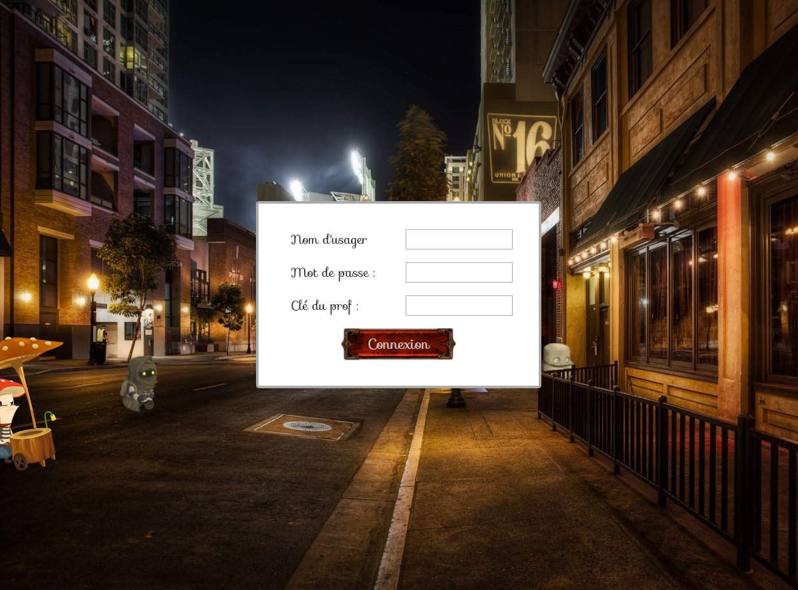

> **Note importante** : Vous ne devez pas ajouter le champ « Clé du prof ». Cela ne sert qu'à mon thème à moi, empêchant les étudiants de se connecter dans mon thème et d'analyser/copier tout mon code JavaScript.

### Page « lobby »

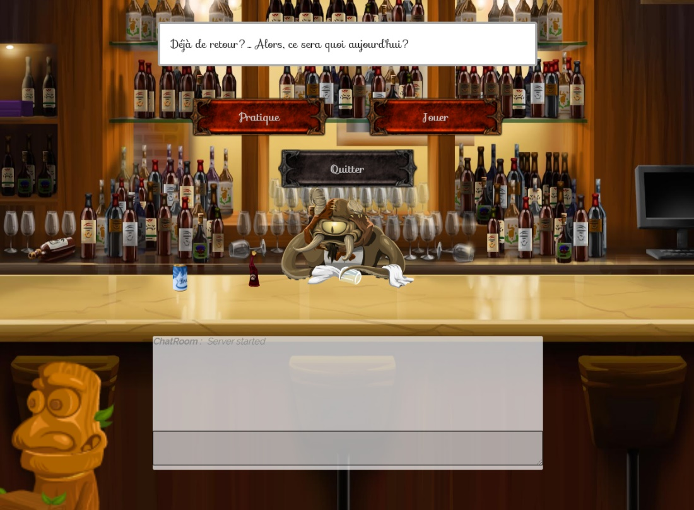

### Page de jeu

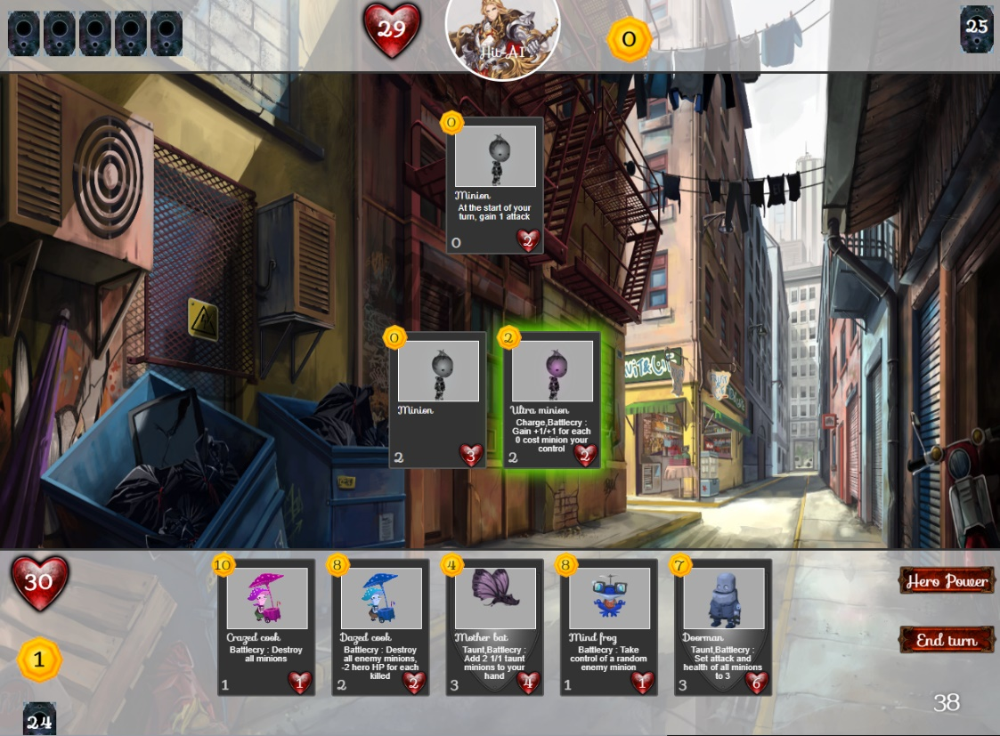

---

## Le commencement

Avant même d'utiliser l'API, il faut avoir terminé de créer son compte sur le serveur Magix.

### L'enregistrement

Pour ce faire, il doit aller au lien suivant, et remplir le formulaire d'inscription :

<https://magix.apps-de-cours.com/server/signup>

### Créer son « Deck »

Un deck est un ensemble de 30 cartes sélectionnées par l'utilisateur. Il faut donc se connecter sur le site Web, puis aller dans la section « Deck » pour créer son deck. Lorsque votre deck est terminé, vous pouvez développer votre version du jeu.

---

## Le jeu

### L'objectif

Le but du jeu est de réduire la vie de l'adversaire à zéro, en attaquant avec ses cartes. Le jeu est fortement inspiré du jeu « Hearthstone » de la compagnie Blizzard.

### Les cartes

#### L'état d'une carte sur le jeu

Une carte ayant son state « IDLE » peut être jouée, alors qu'une carte « SLEEP » ne peut être jouée avant le prochain tour.

#### Placer une carte sur le jeu

Pour jouer une carte qui se trouve dans votre main, vous devez avoir suffisamment de « mp ».

#### Une carte « charge »

Ce type de carte déposée sur le jeu peut immédiatement attaquer, alors que les autres doivent attendre au tour suivant.

#### Une carte « taunt »

L'adversaire ne peut attaquer le héros ou les autres cartes derrière les cartes « taunt ».

#### Une carte « stealth »

L'adversaire ne peut attaquer une carte « stealth » en la ciblant avec une de ses cartes. Lorsqu'une carte « stealth » attaque, elle perd ce statut.

#### Une carte « confused »

Une carte confused est une carte qui a été volée à l'adversaire (volée pour 1 seul tour).

#### Une carte « battlecry »

Cette carte fait une action lorsqu'elle est déposée sur le jeu (board).

#### Une carte « deathrattle »

Cette carte fait une action lorsqu'elle meurt et est retirée du jeu (board).

### Temps accordé pour jouer son tour

Un joueur peut prendre jusqu'à 50 secondes pour jouer son tour. Lorsqu'il a terminé de faire ses actions, il peut cependant faire l'action « END_TURN » pour le terminer plus rapidement.

---

## Se connecter à l'API

Pour créer un jeu, il est nécessaire de communiquer avec le serveur de Magix. Vous devrez donc faire appel à son API.

Voici un exemple d'appel qui permet de faire l'opération « signin ». Il est **FORTEMENT** conseillé d'utiliser cette fonction telle quelle et de la placer dans « CommonAction ».

```php
/**
 * data = ['key1' => 'value1', 'key2' => 'value2'];
 */
protected function callAPI($service, $data) {
  $apiURL = "https://magix.apps-de-cours.com/api/" . $service;
  $result = null;

  if ($service == "games/action") {
    $milliseconds = microtime(true) * 1000;

    if (!empty($_SESSION["lastActionCall"]) &&
        $milliseconds - $_SESSION["lastActionCall"] < 250) {
      $result = json_encode("TOO_MANY_ACTIONS");
    }

    $_SESSION["lastActionCall"] = $milliseconds;
  }

  if (empty($result)) {
    $options = [
      'http' => [
        'header'  => "Content-type: application/x-www-form-urlencoded\r\n",
        'method'  => 'POST',
        'content' => http_build_query($data)
      ]
    ];

    $context = stream_context_create($options);
    $result = file_get_contents($apiURL, false, $context);

    if (strpos($result, "<br") !== false) {
      $result = json_encode($result);
    }
  }

  return json_decode($result);
}
```

**Exemple d'appel (à intégrer dans votre action)**

```php
$data = [];
$data["username"] = "Falcor";
$data["password"] = "AAAaaa111";

$result = parent::callAPI("signin", $data);

if ($result == "INVALID_USERNAME_PASSWORD") {
  // err
}
else {
  // Pour voir les informations retournées : var_dump($result);exit;
  $key = $result->key;
}
```

---

## La boîte de chat (clavardage)

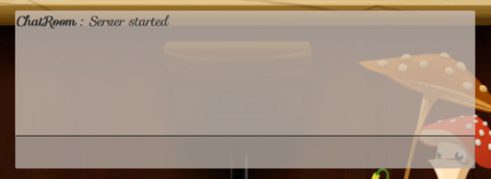

Pour faire apparaître la boîte de *chat* dans votre page Web, il s'agit d'injecter votre clé de session (reçue lors de l'authentification) dans l'extrait de code HTML suivant :

**Version normale :**

```html
<iframe width={700} height={240}
        src="https://magix.apps-de-cours.com/server/chat/votre-clé-ici">
</iframe>
```

### Styliser votre boîte de chat

Afin de modifier le style de votre boîte de chat, il s'agit de faire ce qui suit.

1. Dans la création de l'iframe, ajouter l'événement `onLoad`.

   ```html
   <iframe ref={chatRef} width={700} height={240} onLoad="applyStyles()"
           src="https://magix.apps-de-cours.com/server/chat/votre-clé-ici">
   </iframe>
   ```

2. Déclarer la fonction `applyStyles()`. Voici un exemple :

   ```javascript
   const chatRef = useRef(null);

   const applyStyles = () => {
     let styles = {
       fontColor : "#333",
       backgroundColor : "rgba(87, 41, 5, 0.2)",
       fontGoogleName : "Sofia",
       fontSize : "20px",
       hideIcons : false, // (or true)
       inputBackgroundColor : "red",
       inputFontColor : "blue",
       height : "690px",
       padding: "5px",
       memberListFontColor : "#ff00dd",
       borderColor : "blue",
       memberListBackgroundColor : "white",
       hideScrollBar: true, // pour cacher le scroll bar
     }

     setTimeout(() => {
       chatRef.current.contentWindow.postMessage(JSON.stringify(styles), "*");
     }, 100);
   }
   ```

3. Si vous désirez modifier la police de caractères, utilisez `fontGoogleName`. Cela doit correspondre au nom d'une police disponible à cet endroit : <https://fonts.google.com/>

> - Il n'y a que les styles plus hauts qui sont acceptés.
> - Tous ces styles sont optionnels, vous pouvez donc utiliser seulement les éléments qui vous conviennent.

---

## La page de deck

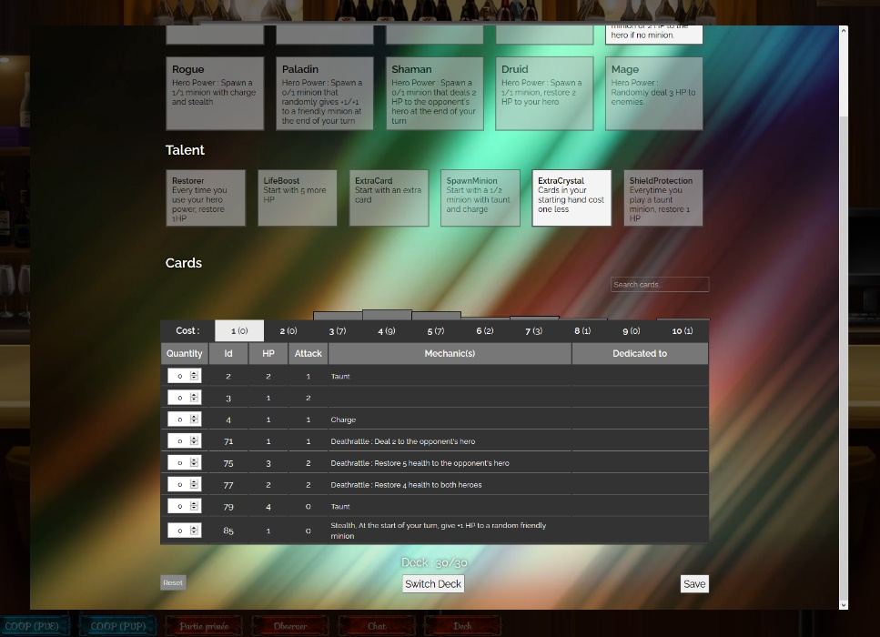

Afin d'éviter de toujours vous connecter sur le serveur de Magix pour modifier votre deck, vous pouvez l'ajouter de la même façon que le chat :

```html
<iframe src="https://magix.apps-de-cours.com/server/deck/votre-clé-ici">
</iframe>
```

---

## Les services disponibles (l'API)

### Connexion au serveur

Pour faire une authentification auprès du serveur, il faut avoir complété son inscription (voir plus haut). Lors d'une connexion, le serveur vous retournera une clé. Celle-ci doit être conservée en session car tous les autres appels au serveur en dépendent. Cette clé permet au serveur de « vous reconnaître » (savoir qui vous êtes).

| Nom du service | `signin` |
| --- | --- |
| **Paramètres** | `username` : le nom de votre personnage<br>`password` : votre mot de passe |
| **Retour (succès)** | Informations de votre personnage et la clé de session. La clé aura cette forme (50 car.) : `afsc9sflasmknc5lkntasd9yhcbasdfnasd9fcn` |
| **Retour (erreur)** | `"INVALID_USERNAME_PASSWORD"` : erreur d'authentification |

Pour savoir comment implémenter ce service, veuillez regarder l'exemple plus haut.

### Déconnexion du serveur

Lorsque vous êtes connecté, vous pouvez vous déconnecter en passant au service votre clé de session.

| Nom du service | `signout` |
| --- | --- |
| **Paramètres** | `key` : votre clé. Elle *doit être envoyée dans un tableau, même s'il n'y a que la clé en paramètre.* Exemple : `$data = []; $data["key"] = "asfsdafdsf54879y…";` |
| **Retour (succès)** | `"SIGNED_OUT"` |
| **Retour (erreur)** | `"INVALID_KEY"` |

### Créer/Joindre une partie

Permet de jouer une partie contre une autre personne (pvp), ou contre l'ordinateur (training).

| Nom du service | `games/auto-match` |
| --- | --- |
| **Paramètres** | `key` : votre clé<br>`type` : `"PVP"` ou `"TRAINING"`<br>`mode` (optionnel) : `"STANDARD"`, `"COOP"` ou `"ARENA"`<br>`privateKey` (optionnel) : permet de créer une partie privée entre 2 joueurs, en utilisant un mot de passe pour accéder à la partie. *Vous n'avez pas besoin d'intégrer ce paramètre, il est optionnel.* |
| **Retour (succès)** | `"JOINED_PVP"`<br>`"JOINED_TRAINING"` |
| **Retour (erreur)** | `"INVALID_KEY"`<br>`"INVALID_GAME_TYPE"`<br>`"DECK_INCOMPLETE"`<br>`"MAX_DEATH_THRESHOLD_REACHED"` : lors de tournoi seulement. Lorsque vous avez cette erreur, vous êtes mort! |

Après cet appel, vous êtes dans une partie, *game on!*

L'idée est donc de faire en sorte qu'après l'appel de ce service, vous alliez sur `jeu.php` (ou `game.php`), et commenciez à faire des appels pour avoir l'état du jeu (voir section suivante).

Il existe également le type `TRAINING_SLOW`, qui permet de faire une partie avec une AI, mais où cette dernière joue plus lentement.

### Modes du jeu

- **STANDARD** : jeu traditionnel, 2 personnes qui s'affrontent avec leur « deck ».
- **COOP** : pour gagner, les 2 joueurs doivent tuer un mega-minion sur le « board ».
- **ARENA** : jeu traditionnel, mais les cartes en main sont choisies aléatoirement et selon le niveau de son arène (le niveau peut augmenter en jouant une carte spéciale).

### L'état de la partie en cours

Lorsque le personnage est dans la partie, il faut demander régulièrement son état afin de savoir si votre vie a diminué, quelles sont les cartes dans votre main, etc.

Il doit y avoir un délai de 2 secondes minimum entre chaque appel. Autrement, l'appel pourrait être refusé et vous pourriez même être déconnecté!

| Nom du service | `games/state` |
| --- | --- |
| **Paramètres** | `key` : votre clé |
| **Retour (succès)** | `"WAITING"` : en attente d'un autre joueur<br>`"LAST_GAME_WON"` : la partie n'existe plus, mais la dernière partie jouée a été gagnée<br>`"LAST_GAME_LOST"` : la dernière partie n'existe plus et vous l'aviez perdue<br>ou un document JSON contenant l'état de la partie (voir exemple plus bas) |
| **Retour (erreur)** | `"INVALID_KEY"` |

> **Éviter d'être banni du serveur et les délais d'appel**
>
> Pour le service `games/state` : un délai de 2 secondes minimum entre chaque appel.
>
> Il est donc nécessaire d'attendre le retour de l'appel du service avant d'en lancer un autre!

Voici un extrait de code React à mettre dans votre page de jeu qui devrait vous aider.

```javascript
const fetchState = () => {
  fetch("/api/game-state.php")
    .then(response => response.json())
    .then(response => {
      console.log(response) // <-- État du jeu, ou message comme : LAST_GAME_WON
      stateTimeout.current = setTimeout(fetchState, 2000);
    });
}

useEffect(() => {
  stateTimeout.current = setTimeout(fetchState, 1000);

  return () => {
    if (stateTimeout.current) clearTimeout(stateTimeout.current);
  }
}, []);
```

**Exemple de résultat (JSON)**

```json
{
  "remainingTurnTime": 24,
  "yourTurn": true,
  "heroPowerAlreadyUsed": false,
  "hp": 30,
  "mp": 0,
  "maxMp": 1,
  "hand": [
    {"id": 4,  "cost": 2, "hp": 3, "atk": 2, "mechanics": [], "uid": 3, "baseHP": 3},
    {"id": 22, "cost": 7, "hp": 7, "atk": 7, "mechanics": [], "uid": 5, "baseHP": 7},
    {"id": 10, "cost": 3, "hp": 3, "atk": 3, "mechanics": ["taunt", "charge"], "uid": 6, "baseHP": 3}
  ],
  "board": [
    {"id": 2, "cost": 1, "hp": 1, "atk": 2, "mechanics": [], "uid": 7, "baseHP": 1, "state": "SLEEP"}
  ],
  "welcomeText": "My life for Aiur!",
  "heroClass": "Warrior",
  "remainingCardsCount": 24,
  "opponent": {
    "username": "Dummy-AI",
    "heroClass": "Hunter",
    "hp": 30,
    "mp": 0,
    "board": [],
    "welcomeText": "Die, maggot!",
    "remainingCardsCount": 24,
    "handSize": 3
  },
  "latestActions": []
}
```

> `latestActions` : une liste des dernières actions jouées dans la partie.

### Pour faire une action (jouer une carte, terminer son tour, attaquer)

| Nom du service | `games/action` |
| --- | --- |
| **Paramètres** | `key` : votre clé<br>`type` : `"END_TURN"`, `"SURRENDER"`, `"HERO_POWER"`, `"PLAY"` ou `"ATTACK"`<br>`uid` (pour `PLAY` et `ATTACK`) : id unique de la carte dans la partie (ex : 23)<br>`targetuid` (pour `ATTACK`) : uid de la carte attaquée, ou `0` (zéro) pour le héros adverse |
| **Retour (succès)** | L'état de la partie modifiée |
| **Retour (erreur)** | voir tableau ci-dessous |

Les combinaisons de paramètres possibles sont :

- `key` + `type` (`END_TURN`, `SURRENDER` ou `HERO_POWER`)
- `key` + `type` (`PLAY`) + `uid`
- `key` + `type` (`ATTACK`) + `uid` + `targetuid`

**Codes d'erreur de `games/action`**

| Erreur | Signification |
| --- | --- |
| `INVALID_KEY` | Clé invalide |
| `INVALID_ACTION` | Action invalide |
| `ACTION_IS_NOT_AN_OBJECT` | Mauvaise structure de données |
| `NOT_ENOUGH_ENERGY` | La carte coûte trop cher à jouer |
| `BOARD_IS_FULL` | Pas assez de place pour la carte |
| `CARD_NOT_IN_HAND` | La carte n'est pas dans votre main |
| `CARD_IS_SLEEPING` | Carte ne peut être jouée ce tour-ci |
| `MUST_ATTACK_TAUNT_FIRST` | Une carte taunt empêche ce coup |
| `OPPONENT_CARD_NOT_FOUND` | La carte attaquée n'est pas présente |
| `OPPONENT_CARD_HAS_STEALTH` | La carte ne peut être attaquée tant qu'elle possède « stealth » |
| `CARD_NOT_FOUND` | La carte cherchée (uid) n'est pas présente |
| `ERROR_PROCESSING_ACTION` | Erreur interne, ne devrait pas se produire |
| `INTERNAL_ACTION_ERROR` | Autre erreur interne, bug du prof? |
| `HERO_POWER_ALREADY_USED` | Pouvoir déjà utilisé pour ce tour |
| `TOO_MANY_ACTIONS` | Délai trop court entre 2 actions |
| `TOO_MANY_ACTIONS_BAN` | Délai trop court entre 2 actions |

> **IMPORTANT** : Pour éviter de vous faire bannir, assurez-vous d'avoir reçu le retour de l'action précédente avant de permettre une nouvelle action.

---

## Autres notes importantes

Voici quelques notes importantes concernant le serveur Magix.

### Le quasi temps-réel

Étant donné que `fetch` est utilisé au lieu des Web Sockets pour le jeu, le jeu ne fonctionne pas tout à fait en temps réel. C'est donc normal que lorsque l'un des joueurs fait une action, un autre joueur ne la voie pas instantanément.

### Distinguer un message texte d'un objet dans une variable

Voici un exemple de code qui permet de voir si la variable est un objet ou une simple chaîne de caractères. Ça peut être utilisé pour savoir si la partie est terminée ou pas.

```javascript
if (typeof maVariable !== "object") {
  if (maVariable == "GAME_NOT_FOUND") {
    // Fin de la partie. Est-ce que j'ai gagné? Je dois appeler user-info
  }
}
else {
  // maVariable est un objet. On pourrait faire, par exemple, maVariable.game.hp ou
  // maVariable.player.mp
}
```

### Observer une partie (optionnel)

Il est possible d'observer une partie en utilisant le service suivant, qui fonctionne exactement comme le service `games/state`, que l'on appelle à chaque seconde.

| Nom du service | `games/observe` |
| --- | --- |
| **Paramètres** | `key` : votre clé<br>`username` : nom du joueur à observer |
| **Retour (succès)** | `"WAITING"` : en attente d'un autre joueur<br>`"LAST_GAME_WON"` : la partie n'existe plus, mais la dernière partie jouée a été gagnée<br>`"LAST_GAME_LOST"` : la dernière partie n'existe plus et vous l'aviez perdue<br>`"NOT_IN_GAME"` : le joueur n'est pas dans une partie<br>ou un document JSON contenant l'état de la partie (voir exemple plus haut) |
| **Retour (erreur)** | `"INVALID_KEY"` |

---

## Divers

Il existe plusieurs autres services disponibles. Si jamais vous êtes intéressés, n'hésitez pas à me contacter.

Exemples :

| Service | Description |
| --- | --- |
| `/chat` et `/chat/new` | les messages du chat |
| `/stats` | statistiques |
| `/news` | actualités |
| `/users/deck/switch` | permet d'utiliser son deuxième deck |
| `/talents` | permet d'avoir la liste de talents du jeu |
| `/heroes` | permet d'avoir la liste des héros |
| `/cards` | permet d'avoir la liste de cartes du jeu |
| `/users/info` | permet d'avoir des informations sur ton joueur |

### Exemple : sauvegarder un deck

Pour sauvegarder un deck, il vous faut :

- Obtenir votre deck actuel, votre classe et votre talent initial via le service `/api/users/deck` (avec votre clé).
- Obtenir la liste des cartes, via le service `/cards`.
- Obtenir la liste des talents, via le service `/talents`.
- Obtenir la liste des héros, via le service `/heroes`.
- Sauvegarder votre nouveau deck, via le service `/api/users/deck/save`, avec ces informations :

```text
key : <votre clé>
deck : [<un tableau de id de cartes>], (3 ids identiques maximum)
className : <nom de votre classe/héros>,
initialTalent : <nom de votre talent initial>,
```

---

## Exemples de thème

Quelques exemples faits par les étudiants dans le passé…

### Games of Thrones (par J.C. Bertrand)

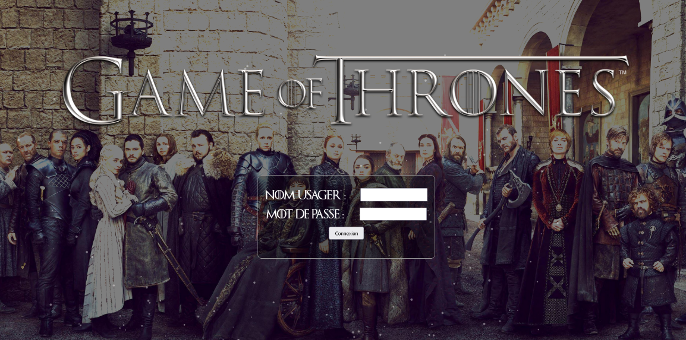


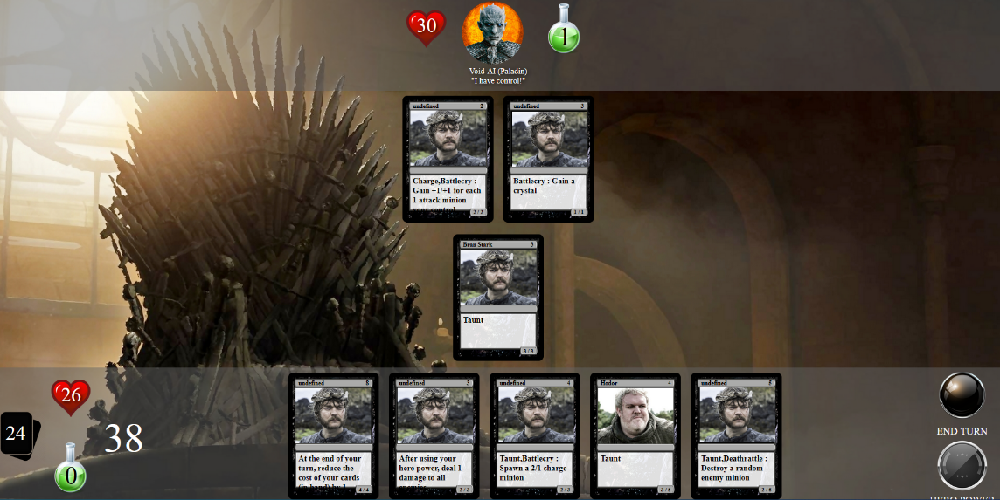

### The Witcher (par L. Labrecque)

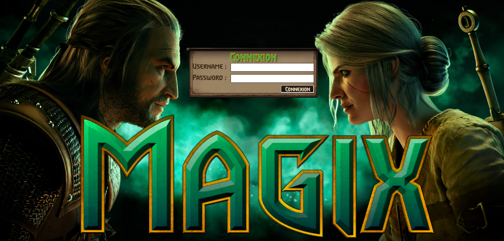

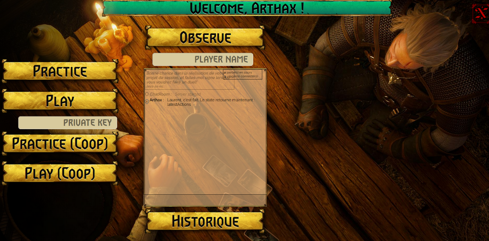

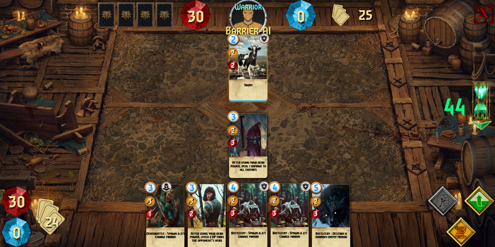

### D&D (par N. Paquette)

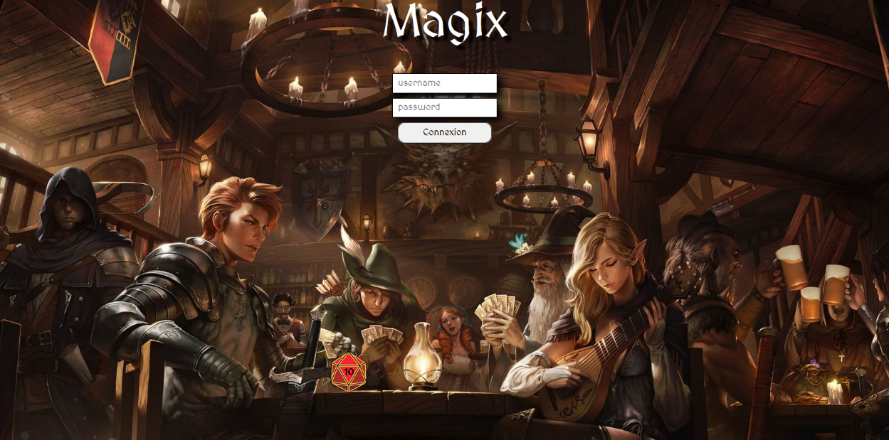

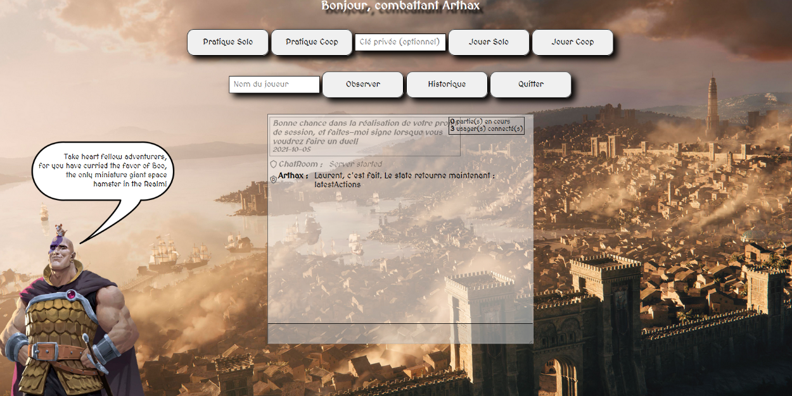

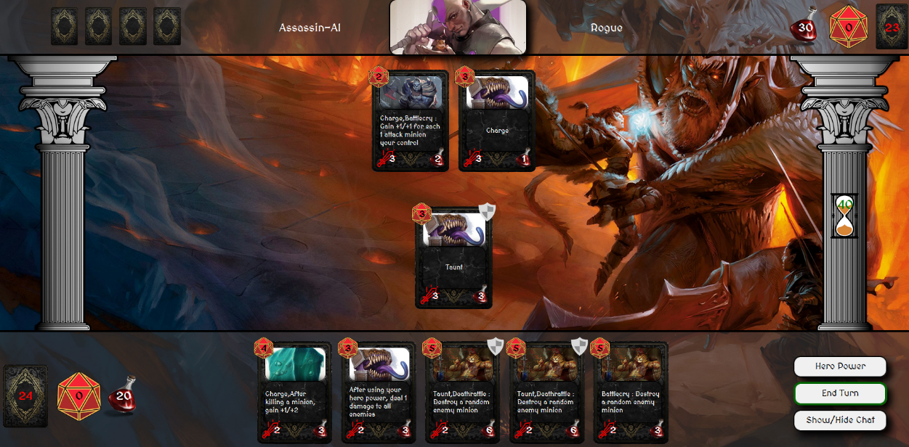

### Western (par M. Davidov)

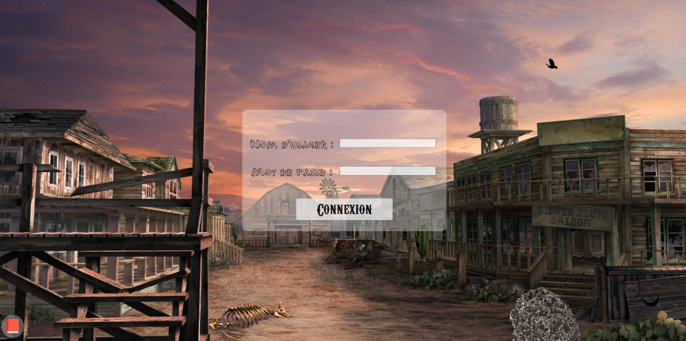

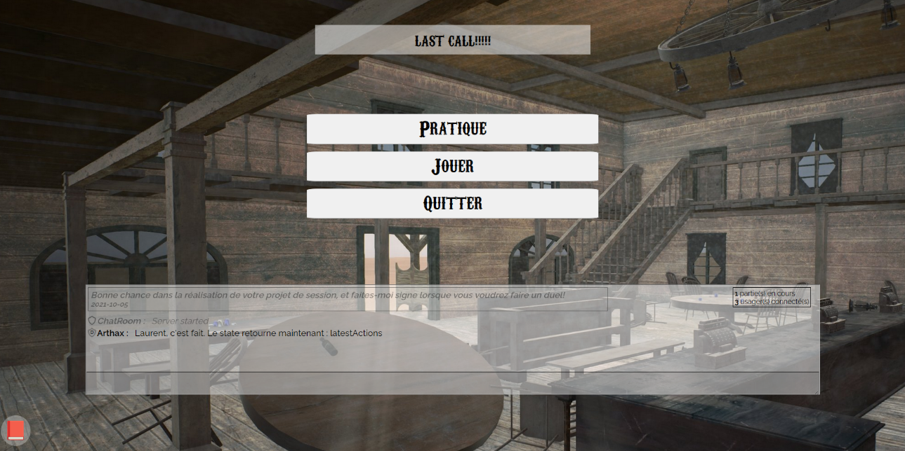

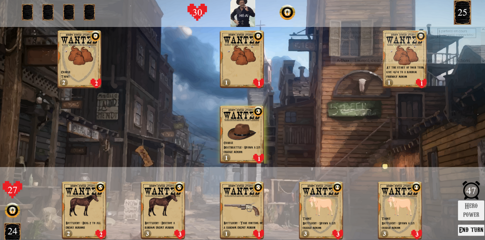
